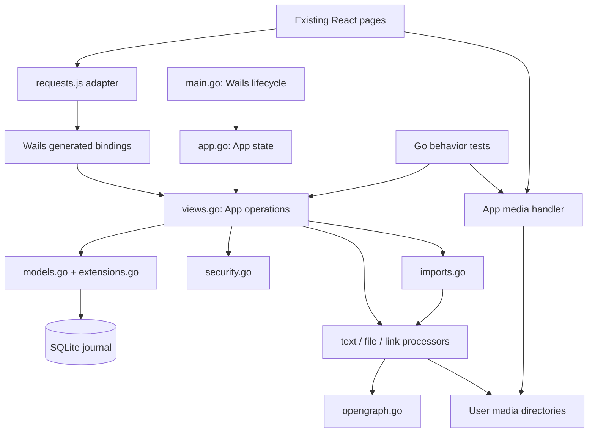
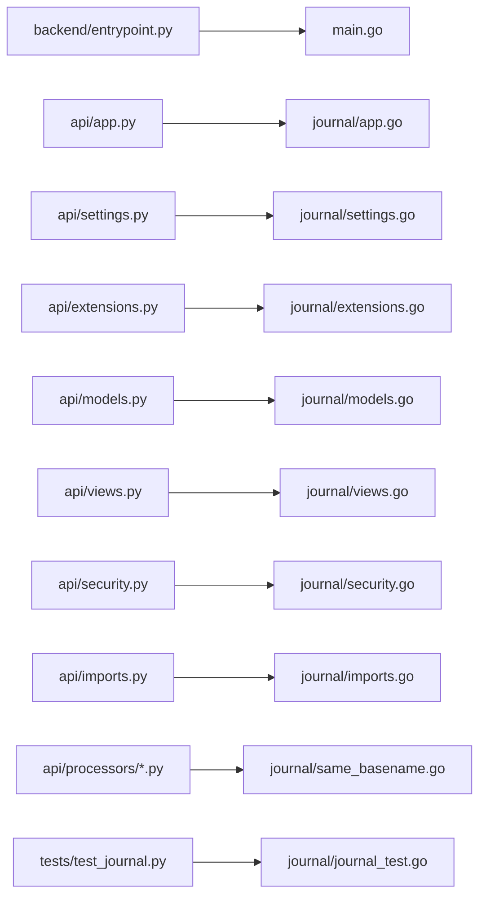

# Innerly: TDD migration to Go + Wails

Original status: **planning only**. Implementation handoff for branch `golang_tdd_migration`.

The plan below is retained as the original design. Implementation and validation are now recorded in [wails-implementation.md](wails-implementation.md), including deliberate deviations and remaining manual acceptance checks.

## 1. Goal and boundaries

Replace Flask/Python with Go behind a Wails desktop application while keeping the existing React UI and journal storage format. Keep Go filenames and method names recognizably related to Python; do not introduce a repository/service/controller framework or rewrite the UI.

Recommended target: **Wails v2, React/JavaScript, macOS first**. Use the stable v2 toolchain rather than adopting v3 as part of this migration. Confirm the installed version and its requirements before scaffolding. Windows/Linux packaging, signing, automatic updates, sync, and UI redesign are later work.

The current source is the behavioral reference. `docs/migration-test-plan.md` is a broader inventory, not a completed suite. The current suite contains 28 tests in `backend/tests/test_journal.py`; the prior run passed all 28. This planning task has not rerun them. The implementation agent must establish a fresh baseline.

Three previously approved fixes are already implemented and must survive the port:

- Search includes entry-level tags, without duplicate rows or cross-user/day-tag leakage.
- Password changes enforce the signup-equivalent eight-character minimum before modifying data.
- Link fetching is **HTTPS-only**, with public-address validation/pinning, redirect checks, TLS verification, bounded responses, and safe preview failures. Do not reintroduce HTTP support.

Do not fix unrelated Python bugs, refactor production Python for tests, or change import semantics. The timer to purge expired lock keys remains a TODO. Physical-file cleanup on entry deletion remains an unresolved product decision, not permission to fix it during the port.

## 2. Setup the owner can do immediately

Observed on this machine: macOS, Go reports `go1.27.1 darwin/arm64`, Node `v24.21.0`, npm `12.0.2`, and Xcode Command Line Tools at `/Library/Developer/CommandLineTools`. `wails` was not found on PATH. These are observations, not a verified compatible Wails toolchain.

No developer account, application signing certificate, Docker service, or Python bundling is required for a local development build.

From any directory, install the CLI and run diagnostics:

```bash
go install github.com/wailsapp/wails/v2/cmd/wails@latest
export PATH="$(go env GOPATH)/bin:$PATH"
wails version
wails doctor
```

Record the resolved v2 release for the agent; pin that CLI version and the matching Go module version during implementation. If installation reports incompatibility, use a Go version supported by that Wails release rather than changing application code to accommodate the toolchain. Follow diagnostic instructions for missing native dependencies. Only run `xcode-select --install` if diagnostics report that the command-line tools are missing.

Optional smoke test **outside this repository**, in a new empty directory:

```bash
mkdir -p ~/tmp/innerly-wails-check
cd ~/tmp/innerly-wails-check
wails init -n innerly-check -t react
cd innerly-check
wails dev
```

Confirm a native window opens. Share `wails version`, `wails doctor`, and any errors with the implementation agent. Do not run `wails init` over this repository's `frontend/`; it could replace existing application files. These commands are instructions, not actions performed in this planning phase.

References to verify at implementation time:
- https://wails.io/docs/gettingstarted/installation
- https://wails.io/docs/gettingstarted/firstproject
- https://wails.io/docs/reference/options
- https://wails.io/docs/reference/runtime/intro

## 3. Architecture: one application package, one desktop entrypoint

Keep the new Go module at the repository root. Keep Python runnable alongside it until acceptance. Use a single `internal/journal` package for application logic; flatten the Python `processors/` files into that package to avoid circular imports between processing, security, and models. Preserve their basenames.

```text
main.go                         Wails window, embedded frontend, lifecycle wiring
wails.json                      Existing frontend install/build/dev commands
go.mod / go.sum                 Pinned Go dependencies
internal/journal/
  app.go                        App state, NewApp, CloseApp, lifecycle
  settings.go                   Paths/config loading
  extensions.go                 SQLite open/close setup
  models.go                     Records, SQL persistence, serialization/migrations
  views.go                      Bound application operations matching Python routes
  security.go                   Passwords, encryption, lock-key cache
  imports.go                    Legacy archive import and job state
  entry_models.go               Text/file/link data shapes
  text_processor.go             Word counts and sentiment
  keywords.go                   Existing keyword lists
  file_processor.go             Image validation/storage and MediaHandler(app)
  link_processor.go             HTTPS fetch/preview processing
  opengraph.go                   HTML metadata and decoding
  journal_test.go               Ported behavior workflows, no native window required
  testdata/                     Synthetic journal/archive fixtures as needed
frontend/                       Existing React app, minimal adapter changes
backend/                        Frozen executable reference and Python tests
backend/tests/fixtures/
  encryption.json               Shared immutable cryptographic fixture
```

Use `App` fields for DB, paths, current account, lock-key cache, and import jobs instead of package globals. Use ordinary structs and functions, explicit SQL, and small mutexes for shared state. Do not add interfaces for every helper. Tests should drive real operations and real temporary SQLite/files; substitute only network/time boundaries when necessary.

`main.go` calls `journal.NewApp(config)`, binds that `*journal.App` in Wails, and calls the standalone `journal.CloseApp(app)` during shutdown. Standalone constructors/lifecycle functions are not bound operations. Keep Wails imports out of `internal/journal` so its tests do not need a window or desktop runtime. Do not export internal helpers as `App` methods, because exported methods on the bound object become frontend-callable.

### Runtime diagram



### File correspondence diagram



## 4. File and method correspondence

Names below are intended implementation names, not requirements to reproduce Flask/SQLAlchemy machinery. Internal helper functions should normally start lowercase in Go. Public bound operations use exported names.

| Python source | Go counterpart and responsibility |
|---|---|
| `entrypoint.py` | `main.go`: start Wails, embed `frontend/dist`, open application, attach media handler, close application |
| `app.py:create_app` | `app.go:NewApp(config)`: initialize DB/schema and state; no Flask server |
| `settings.py` | `settings.go:LoadSettings(dataDir)`: existing config/path conventions; explicit test data directory |
| `extensions.py:db` | `extensions.go:openDatabase`, `CloseApp`: `database/sql` lifecycle, not a global ORM |
| `models.py:User, Entry, Tag, EntryTagXref, DateTagXref` | Same record names in `models.go`, same table/column names and JSON keys |
| `BaseModel.save/update/delete` | Explicit small insert/update/delete SQL functions; use `sql.Tx` for atomic multi-record operations; no generic active-record layer |
| `get_datetime`, `getattr_typed`, `json`, `short_json` | Timestamp encoding and public response conversion helpers; redact password hashes, preserve preview behavior |
| `apply_column_migrations` | `applyColumnMigrations`: existing additive migration, safe to run again |
| `upsert_day_tag`, `clear_day_tag_if_unused`, `upsert_tags` | `upsertDayTag`, `clearDayTagIfUnused`, `upsertTags` with the existing normalization/association behavior |
| `entry_models.py` | `entry_models.go`: compatible text/file/link response data and JSON fields |
| `text_processor.py` | `processTextEntry`, `buildEntryData`, `countWords`, `getSentiment`, `sentimentIndexToValue` |
| `keywords.py` | `keywords.go`: same positive/negative/negation vocabulary |
| `file_processor.py` | `processFileEntry`, `saveFile`, `deleteFile`, `parseFile`, `validateImage`, `getUserDirectory`, `getPublicPath` |
| `link_processor.py` | `validateURL`, `publicAddress`, `connectPublic`, `buildHTTPClient`, `fetch`, `doOpenGraph`, `downloadFile`, `processLinkEntry` |
| Python HTTPS connection/handler/redirect classes | One Go `http.Transport`/`http.Client` configuration; no class-for-class wrappers |
| `opengraph.py` | `parseOpenGraph`, `decodeHTML`; use an HTML parser, preserve duplicate-meta and charset behavior |
| `imports.py` | Same conceptual `ImportFailure`, `ImportJobState`, `ImportJobManager`; `validateZIP`, `readCSVRows`, `importEntries`, `parseBytesRepr`, `parseUTCDatetime`, `decrypt`, `unlockText` |
| `_import_worker` | A cancellable goroutine calling `importEntries`; no Flask context |

### `views.py` → `views.go` operations

Use request structs for methods with several arguments, not large positional parameter lists. Keep frontend-facing JSON names in `snake_case` using struct tags. Use pointers for optional booleans/numbers where omitted differs from explicit false/zero.

| Current route/function | Bound Go method |
|---|---|
| `index` / version | `Version()` |
| `signup`, `login` | `Signup(input)`, `Login(input)` during compatibility-first migration |
| New local-session operations | `CurrentUser()`, `Logout()` |
| `reset_password` | `UpdatePassword(input)` |
| `update_user` | `UpdateUser(id, input)`; preserve account ownership/admin restrictions |
| `insert_entry` | `InsertEntry(input)`; same text/file/link dispatch |
| `update_entry` | `UpdateEntry(id, input)` |
| `fetch_entries` | `FetchEntries(query)` |
| `fetch_entry` GET/POST | `FetchEntry(id, password)`; no password = stored view, supplied password = password-authenticated read |
| `delete_entry` | `DeleteEntry(id)` |
| `lock_entry`, `unlock_entry`, `auth_lock_key_cache` | `LockEntry(id, password)`, `UnlockEntry(id, password)`, `AuthenticateLock(password)` |
| `insert_date_tag`, `delete_date_tag` | `InsertDateTag(input)`, `DeleteDateTag(id)` |
| `fetch_tagged_days`, `fetch_date_tags`, `fetch_tags` | `FetchTaggedDays()`, `FetchDateTags(query)`, `FetchTags(query)` |
| `fetch_activity`, `fetch_memories` | `FetchActivity(query)`, `FetchMemories(date)` |
| `get_file` | Standalone `MediaHandler(app)` returning an HTTP handler for Wails assets; not an exported method on the bound App or a general-purpose file reader |
| `import_files`, `start_import`, `import_status`, `cancel_import` | `ImportFiles()`, `StartImport(input)`, `ImportStatus()`, `CancelImport()` |
| `share` | Retire; no desktop invitation endpoint |
| `get_settings`, `lock_on_insert`, `entry_json_with_text`, `parse_functional_datetime`, `date_tag_json`, `entry_word_count` | Small equivalent helpers in `views.go`; not new public methods |

### `security.py` correspondence

- Keep `validateEmail`, `validatePassword`, `encryptPassword` (password hashing despite the historical name), and `authenticated`.
- Keep `create32ByteKey`, `isLockedText`, `lockText`, `unlockText`, `unlockTextAtVersion`, `lockEntryData`, `unlockEntryData`, and `entryRelocker` as focused helpers.
- Keep `parseLockTTL`, `getLockTTL`, `deriveScryptKey`, `getScryptKey`, and `clearScryptKey`, scoped to application/account state.
- Replace `login_required` with one current-account check at the start of bound operations. Never accept a frontend-supplied owner ID as authorization.
- Replace `json_abort` with application errors/outcomes. Do not port `abort` control flow.
- Retire bearer-token production/parsing (`get_token`, `get_identity_from_header`, `get_user_identity`, `get_user`) and five-day HTTP sessions. No JWT/session-token library needed.
- File signatures are a transport concern. The recommended desktop media handler uses the selected authenticated account rather than recreating Python signed URLs. Do not rewrite stored media paths.

## 5. Desktop behavior decisions for review

These are proposed defaults, not silently approved product changes. Confirm them before implementation:

1. **Keep existing accounts/passwords initially, drop bearer tokens.** Retain Signup/Login UI temporarily to initialize or select an account. Login establishes an in-memory selected user; restart returns to login. Existing multiple users remain supported, and account IDs/emails are preserved. Removing account UI entirely is a later decision; email currently participates in encryption derivation and cannot simply disappear.
2. **Keep the existing storage location initially.** Normal builds use `~/.innerly`; development/tests use an explicitly configured temporary/copied directory. Never point migration tests or first development runs at the real journal. Do not silently move data to an OS-specific app-data path.
3. **Retain the file input.** Existing browser File input can send a bounded base64 payload through the bridge to `InsertEntry`. This is simpler than introducing native file-picker permissions/path APIs now. Native file selection can follow later; do not expose arbitrary filesystem reads as a binding.
4. **Use an application media handler.** Mount `/media/<filename>` through Wails' asset-server handler and derive the user directory from the authenticated account. Reject separators/traversal and non-owned paths; use no-store responses so switching accounts does not reveal cached private images. Clear visible media on logout. Never serve the whole data directory. This is not a new API server or port.
5. **Keep polling imports.** Preserve existing start/status/cancel UI calls instead of adding an event bus. Stop/join workers before database close. Do not redesign archive validation, imported locking, timestamps, or retry semantics.

If a decision is rejected, amend this plan before coding rather than implementing two transport/storage architectures.

## 6. Data and security compatibility requirements

### SQLite and JSON

Use `database/sql` with a pinned SQLite driver; recommend `modernc.org/sqlite` to avoid adding a SQLite C toolchain requirement. Start with one open DB connection and a bounded busy timeout; keep transactions short. Do not enable new foreign-key/cascade behavior or change timestamp formats incidentally.

Preserve tables, IDs, constraints, `functional_datetime`, `entry_data`, `settings`, and tag associations. SQLite stores current timestamps as naive UTC strings, while public JSON uses ISO timestamps with `Z`; do not rely on a driver's default `time.Time` encoding. Existing settings may decode as a JSON string containing `{}` rather than an object. Preserve unknown JSON metadata such as `import_id` when updating an entry. Return explicit nulls where current frontend behavior depends on them.

Existing entry data is not a closed schema: use typed input/output structs plus a JSON metadata map where necessary rather than silently discarding fields during decode/re-encode. Use Go rune-aware truncation for 64-character previews, not byte slicing. Match whitespace word splitting and representative sentiment results, not Python implementation internals. Keep SQL `EXISTS`-style tag matching so joins do not duplicate entries before pagination.

### Encryption and passwords

Do not invent a new format during migration. Use the committed `backend/tests/fixtures/encryption.json` unchanged as a shared fixture; use a Go Fernet implementation verified against it rather than substituting AES-GCM for current entries. Select/pin a maintained implementation after checking compatibility and license. Go's standard AES-GCM remains suitable for the separate legacy importer format.

Required compatibility details:
- Werkzeug password hashes carry algorithm/iteration/salt information. Parse the stored hash, derive PBKDF2 accordingly, and compare in constant time. Inspect real synthetic fixture variants; do not assume a different account-password algorithm.
- Current lock key: scrypt with salt `innerly-entry-lock` + exact user email, N=16384, r=8, p=1, output length 32 bytes.
- Fernet ciphertext is stored as a Python bytes representation (`b'…'`), not raw base64 alone. Preserve the version marker and legacy version-0 email-based key algorithm.
- Unlocked reads return plaintext without persisting it; ordinary reads of locked entries remain encrypted. The write key cache is not authorization to read private text.
- Lock-by-default encrypts before the first database write. Updates must not double-encrypt supplied ciphertext.
- Password changes validate strength first, then rekey selected records and update the password hash in one SQLite transaction. One corrupt entry rolls back everything.
- Cache state is protected for concurrent bridge calls. Access-time expiry remains; no recurring purge timer in this scope. Clear account-specific state on logout/shutdown; avoid claiming that Go garbage collection guarantees secret-memory zeroization.

### HTTPS processor

Use one configured `http.Client` with a custom transport dialer and redirect policy, corresponding to the current Python processor:
- HTTPS only at input, every redirect, and every thumbnail URL. Do not follow downgrades.
- Resolve all addresses, reject non-public results, and dial a validated literal address without a second resolution. Validate IPv4/IPv6 and mapped forms; preserve the original hostname for TLS SNI/certificate validation.
- Disable environment proxies and TLS verification bypasses. Prefer a simple transport without connection reuse initially; keep behavior predictable and close response bodies.
- Preserve redirect limits, network deadlines, and response byte caps. Go transparently decompresses gzip by default: disable automatic compression, request identity, and reject unsupported content encodings to match Python.
- Resolve relative thumbnails against the final page URL. Missing/blocked/invalid previews keep the bookmark but omit both preview paths; never hand an unsafe external URL to the browser as a fallback.
- Keep detailed errors out of user-facing responses. No live Internet/private-network calls in automated tests.

### Imports

Translate existing importer behavior, do not redesign it. Preserve legacy CSV relationships, Python-bytes parsing without executing code, AES-GCM associated passcode data, per-user import IDs, replacement on reimport, status counters, and cancellation. Existing imported text remains unlocked as it does today. A Go mutex/context replaces thread primitives; it must not introduce different product semantics.

The current passing suite covers a basic text/tag import and reimport, not every importer branch. Additional synthetic image/encrypted/failure/cancellation archives are needed before claiming full import parity. Adding test fixtures is allowed; changing Python importer production code is not.

## 7. Frontend integration contract

Keep most pages unchanged. `frontend/src/requests.js` remains the adapter boundary:

- Replace HTTP fetches with generated `frontend/wailsjs/go/journal/App` bindings (verify generated path after binding the actual package/type).
- Keep helper names and callback/promise behavior used by pages. Normalize returned data at this boundary; do not spread Wails-specific handling through cards/pages.
- Preserve stable error distinctions: unauthorized session, `lock-auth-expired`, invalid input, not found, conflict, and safe network failure. Recommended simple contract: typed result structs with `data`/operation fields and optional `{code, message}` error, so errors survive the bridge without parsing Go exception strings. No requirement to preserve HTTP status numbers outside the Python tests.
- Preserve the password modal and one queued retry after lock reauthentication. Wrong passwords must not be mistaken for expired sessions.
- Audit all direct fetch calls, especially `login-page.jsx`, `sign-up-page.jsx`, and import status calls; centralizing only `requests.js` is not sufficient if pages bypass it.
- Replace token-based checks in `utils.jsx`/`authentication-guard.jsx` with `CurrentUser()` startup state. Local storage is not authorization. Do not persist account passwords or unlocked plaintext.
- Switch the existing `history.js` router to hash mode for desktop deep links. Confirm forward/back, edit state handoff, and reload behavior in a native window.
- Keep `npm run build`; configure Wails' dev command to use existing `npm run start` and its Vite port. Remove dependence on the `/api` proxy only after all calls are converted; no broad frontend tooling upgrade.
- Use Wails' browser-opening runtime API for saved HTTPS links instead of letting the webview navigate away. A small backend URL check or equivalent frontend HTTPS check must also cover historical stored links when opening them externally.
- Upload bytes through the bridge only for selected files; do not use base64 for every image display. Display saved files through the media handler.

Generated bindings are outputs, not hand-edited source. Keep generated/build artifacts under deliberate ignore/commit rules established by the chosen Wails template.

## 8. TDD sequence and stopping points

At every stage: write/port the behavior test first, observe the intended failure, implement the smallest slice, run Go and Python suites, then commit. Do not port every function before exercising a complete workflow.

### Stage 0 — freeze the reference

- Run `cd backend && .venv/bin/python -m unittest discover -s tests -v` and record results/environment.
- Preserve the Python suite and `encryption.json`. Do not generate expected ciphertext using the same Go code being tested.
- Create a synthetic Python-produced SQLite fixture containing multiple accounts, text/file/link records, tags/day tags, and unknown JSON metadata. Keep binary fixtures tiny and include a reproducible test-side generator if needed.
- Add missing compatibility fixtures/tests only where necessary to judge a migration risk; no Python production refactors.
- Confirm the decisions in section 5 and complete the out-of-repo Wails smoke test.

Exit: known-green Python baseline, reviewed contract, no production journal touched.

### Stage 1 — storage and first vertical slice

- Scaffold a pinned Wails module using the scratch template as a reference; retain the existing frontend.
- Implement `settings.go`, `extensions.go`, minimal models/migrations, and `NewApp` against temporary storage.
- Port lifecycle/restart/schema tests; implement create → read → edit → restart → delete for unlocked entries.
- Introduce minimal account selection/authentication needed to exercise ownership; never hardcode user 1.

Exit: Go tests exercise real persisted CRUD and ownership without running Wails.

### Stage 2 — cryptographic compatibility

- Port legacy hash/ciphertext fixtures before implementing security helpers.
- Port locked create/read/edit/unlock, default locking, reauthentication, and password-change workflows.
- Verify rollback with one valid and one corrupt entry, eight-character boundary validation, no plaintext-at-rest, and other-account isolation.

Exit: existing encrypted data is readable, updates remain encrypted, password changes are atomic.

### Stage 3 — queries and day features

- Port search/previews/pagination, entry-tag search, day tags, settings, sentiment/counts, activity/memories.
- Keep existing UTC candidate windows; React still buckets into local days.

Exit: timeline, search, and calendar data match reference fixtures, including locked-tag searches.

### Stage 4 — media and links

- Port image upload/read behavior and the desktop media handler using `httptest` without a window.
- Port HTTPS policy tests with controlled resolver/dial/TLS boundaries; prove blocked destinations are never contacted.
- Preserve image bytes and stored relative paths; do not change the unresolved deletion-cleanup policy.

Exit: HTTPS bookmarks/previews and existing images work without a Python server or public-network test dependency.

### Stage 5 — importer parity

- Port the existing archive/reimport workflow first.
- Add synthetic legacy encrypted/image and failure/cancellation scenarios to both implementations where the existing suite is insufficient.
- Poll real background jobs with bounded waiting; verify shutdown cancellation/join before DB close and run the race detector.

Exit: legacy archives produce equivalent records; importer product semantics remain frozen.

### Stage 6 — bind the existing UI

- Connect generated bindings through the adapter, local-session UI checks, hash routing, uploads/media, and external-browser opening.
- Run desktop smoke journeys: login, write/autosave, lock/read/edit/rekey, search tags, view media, activity/day tags, import/reimport, quit/reopen.
- Check development and packaged builds separately; a working Vite page is not proof that embedded assets work.

Exit: native app works with Python/Docker stopped.

### Stage 7 — release gate

- `go test ./internal/journal/...` and `go test -race ./internal/journal/...` pass.
- Python reference tests remain green; document deliberate transport-only differences.
- `npm run build`, `wails dev`, and `wails build` succeed on the selected macOS toolchain.
- Open only a backup copy of a representative journal for manual acceptance. Close Python/Go before copying SQLite and media, or use SQLite backup APIs; never copy an active DB incompletely.
- Confirm rollback by reopening the backup in the Python app. Do not promise in-place backward compatibility unless tested.
- Do not delete Python, Docker support, or the reference fixtures until the owner accepts the desktop version.

## 9. Test-by-test port ledger

Use Go `Test...` names corresponding to the Python names. Group related cases with subtests; preserve workflows rather than translating Flask request helpers literally. Each Go test gets a temporary application directory and fresh state. Avoid adding helpers/interfaces solely to recreate Python mocks.

| Existing Python test | Go disposition |
|---|---|
| `test_signup_login_and_authorization` | Preserve credential/ownership behavior; replace header/token assertions with local-session checks |
| `test_expired_session_is_rejected` | Retire five-day token behavior; replace with logout/restart requiring login |
| `test_entry_lifecycle_survives_restart` | Direct port through App operations and reopen |
| `test_entry_ownership` | Direct port using separate account sessions |
| `test_search_pagination_and_previews` | Direct port |
| `test_search_entry_tags` | Direct port, including locked entries, no duplicates, day exclusion |
| `test_text_counts_and_sentiment` | Direct port through entry create/read |
| `test_settings_and_default_locking` | Direct port |
| `test_locked_entry_read_edit_and_unlock` | Direct port, including independent persisted-state checks |
| `test_default_locking_and_reauthentication` | Preserve timeout/error/retry outcomes, not global cache structure |
| `test_password_change_rekeys_only_selected_entries` | Direct port |
| `test_password_change_minimum_length` | Direct port |
| `test_password_change_rolls_back_on_corrupt_entry` | Direct port |
| `test_day_tags_lifecycle` | Direct port |
| `test_activity_memories_and_date_queries` | Direct port |
| `test_image_upload_and_signed_retrieval` | Preserve bytes/ownership/validation; replace signed HTTP URL assertions with desktop media access |
| `test_link_preview_and_network_failure` | Direct behavior port, substitute Go transport boundary |
| `test_import_archive_and_reimport` | Direct port with real goroutine and bounded polling |
| `test_legacy_encryption_and_password_compatibility` | Reuse immutable fixture; also assert its known derived key bytes |
| `test_legacy_schema_upgrade_preserves_journal` | Direct port with Python-format DB |
| `test_link_security_blocks_unsafe_destinations` | Direct port; HTTPS-only, DNS/mapped-address rejection |
| `test_link_redirects_pin_public_addresses` | Direct port; disable proxy env, pin destinations, preserve relative previews |
| `test_link_redirect_to_private_host_is_blocked` | Direct port including same-host rebinding and HTTPS→HTTP rejection |
| `test_unusable_previews_do_not_break_bookmarks` | Direct port including HTTP thumbnails and malformed previews |
| `test_https_keeps_hostname_verification` | Preserve certificate/SNI behavior; use controlled TLS certificates rather than disabling verification |
| `test_link_redirect_loop_is_bounded` | Direct port |
| `test_link_response_limits` | Direct port, including encoding/content-length failures |
| `test_frontend_and_unknown_api_routes` | Retire Flask-specific 404/501 assertions; replace with packaged assets/hash-routing smoke checks |

The 28-test suite is the minimum starting point, not proof of exhaustive parity. New tests should cover documented missing compatibility risks, not lock in helper call sequences or every Python branch.

## 10. Implementation-agent handoff checklist

- Read this document, the actual Python implementation, and the current tests before scaffolding.
- Confirm Wails version/platform and section 5 decisions with the owner.
- Keep one Go package for journal logic, one desktop entrypoint, and the existing React UI.
- Keep filenames recognizable; update the correspondence table only when a real Go constraint requires a deviation.
- Run baseline tests and preserve red/green evidence for each migrated workflow.
- Keep all tests/development writes away from the owner's real `~/.innerly`.
- Do not change importer semantics, add HTTP support, redesign auth UI beyond the agreed local-session adapter, or implement unrelated deferred fixes.
- Report remaining parity gaps honestly; do not mark unimplemented tests skipped and call the migration complete.

This document and its diagrams are the deliverable for the current planning phase. No Go module, Wails scaffold, dependencies, or application changes have been created here.
